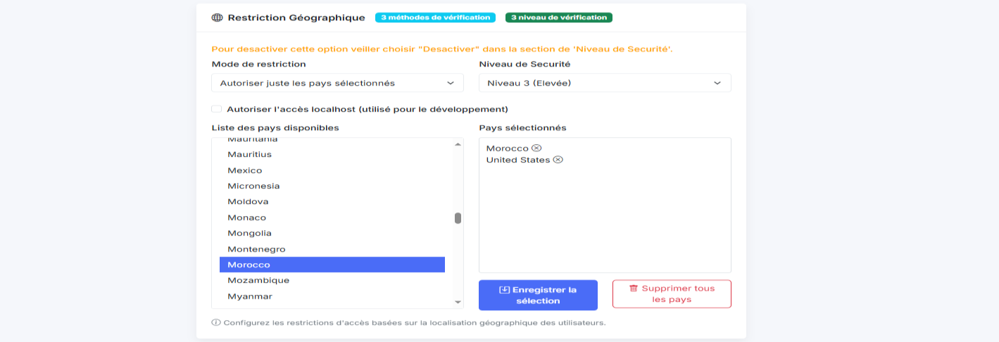

# E-Commerce Access Control

A bachelor's final-year team project studying application security and attribute-based access control in an e-commerce application.

**Academic year:** 2024-2025  


*Schedule and access-mode configuration from the original project report.*

## Objective

Control who can access an e-commerce application using both user attributes and context, rather than login status alone. The project connects administrator-configured policies to protected application routes.

**Explore:** [Policy interface](views/policy.html) · [Access middleware](fonctionnel/middlewares.js) · [Architecture & formal model](docs/project-overview.md)

## Run Locally

Requirements: Node.js 22/24 and Docker Compose v2 (or an isolated MariaDB database).

```sh
npm ci
npm run setup
docker compose up -d --wait
npm run seed
npm start
```

Open **http://localhost:3030/login**. Synthetic accounts: `admin@example.test` and `customer@example.test`; their password is the generated `DEMO_PASSWORD` in your private `.env`.

[Demo walkthrough, tests and troubleshooting](docs/quickstart.md). The real MariaDB login/policy path is tested; the optional Python model is not part of this quickstart.

## Focus

- Authentication and session management.
- Geographic, age and time-based access policies.
- Protected application routes and administrative policy management.
- A Python experiment for suspicious-login detection.
- Access-control modelling in the P language.

## Stack

Node.js, Express, MySQL, HTML/CSS/JavaScript, Python and Flask.

## Attribute-Based Policies


*Age-policy settings: user attributes become inputs to the access decision.*



*Geographic policy: permitted countries and configurable verification levels.*

[Geographic policy flow and visual sources](docs/project-overview.md)

## Code Map

| Component | Source |
| --- | --- |
| Application setup | [server.js](server.js) |
| Authentication and access checks | [auth.js](fonctionnel/auth.js), [middlewares.js](fonctionnel/middlewares.js) |
| Administrative policies | [securityRoutes.js](fonctionnel/routes/securityRoutes.js) |
| Formal state-machine model | [model.p](model.p) |
| Database structure | [schema.sql](database/schema.sql) |

**Technical focus:** separating authentication from authorization, configuring contextual rules, and modelling request/response states. This is an academic prototype, not a production deployment.

<details>
<summary>Publication scope, setup and security limitations</summary>

## Publication Scope

This repository contains selected application source files from the academic project. Login logs, SQL records, uploaded user files, pretrained pickle models, the GeoLite database and third-party image collections are not included.

`database/schema.sql` contains the table structure only. `npm run seed` adds fictional local demonstration records, not the original user data. The Python experiment requires its own data and model artifacts. Original storefront images are omitted, so some image references remain unresolved.

## Local Study

Read `server.js`, `fonctionnel/middlewares.js` and the policy routes to follow access-control decisions. `npm start` loads the local `.env`; see `.env.example` and the [quickstart](docs/quickstart.md).

Use an isolated local database with synthetic records. Portfolio maintenance updates dependencies and protects the policy API with administrator authorization. A complete application-security review is still required before deployment.

The Compose database imports `database/schema.sql` on its first initialization. The server and published database port bind to localhost. Policies start inactive and can be configured through the demo administrator account.

The updated lockfile audit reports **0 known npm vulnerabilities**. This is not a security certification. Three HTTP authorization tests pass, and the real MariaDB smoke test covers schema import, repeated seeding, login, session cookies, policy persistence and customer rejection. Other routes are not certified by that test. Do not expose the academic prototype to the internet.

</details>

## Credits

This is a portfolio edition of a collaborative academic project, not a claim of sole authorship. The original team repository is linked in the [project overview](docs/project-overview.md). No new license is applied to jointly authored or third-party material.
