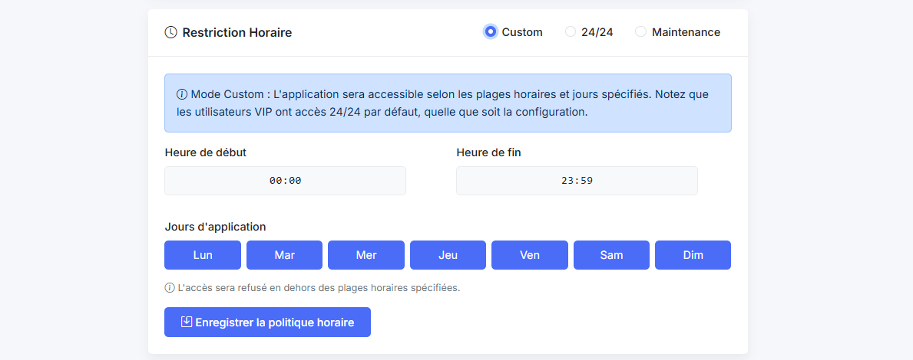
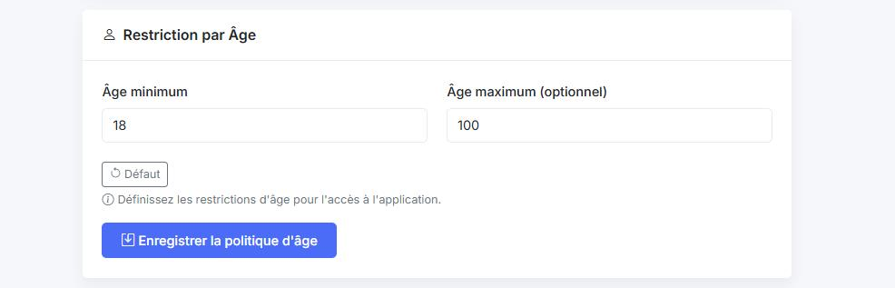

# E-Commerce Access Control

A bachelor's final-year team project studying application security and attribute-based access control in an e-commerce application.

**Academic year:** 2024-2025  
**Authors:** Youssef El Ghouari and Lahcen Houban, with credits retained from the original application  
**Original team repository:** [Yassermar11/pfe](https://github.com/Yassermar11/pfe)

*Schedule and access-mode configuration from the original project report.*

## Focus

- Authentication and session management.
- Geographic, age and time-based access policies.
- Protected application routes and administrative policy management.
- A Python experiment for suspicious-login detection.
- Access-control modelling in the P language.

## Stack

Node.js, Express, MySQL, HTML/CSS/JavaScript, Python and Flask.

## Attribute-Based Policies

*Age-policy settings: user attributes become inputs to the access decision.*

[Geographic policy flow and visual sources](docs/project-overview.md)

Publication scope, setup and security limitations

## Publication Scope

This repository contains selected application source files from the academic project. Login logs, SQL records, uploaded user files, pretrained pickle models, the GeoLite database and third-party image collections are not included.

`database/schema.sql` contains the table structure only, without user or order records. This is a source-code portfolio, not a production deployment. The Python experiment requires its own reviewed data and model artifacts. Original storefront images are omitted, so some image references are intentionally unresolved.

## Local Study

Read `server.js`, `fonctionnel/middlewares.js` and the policy routes to follow the access-control implementation. Configuration uses `DB_HOST`, `DB_USER`, `DB_PASSWORD`, `DB_NAME` and `SESSION_SECRET`; see `.env.example`. Export these variables in your shell before running the application. The project does not automatically load a `.env` file.

Use an isolated local database with synthetic records. Dependency and security updates are required before any deployment. The original dependency versions are retained to document the coursework; they are not an endorsement for production use.

Import `database/schema.sql` into an empty laboratory database before studying the routes. Some policies require synthetic configuration records of your own. The portfolio edition removes the original self-referencing package dependency, uses environment variables for server/database configuration and binds the Express server to localhost.

The publication dependency audit reports 21 vulnerabilities, including 4 critical findings. Do not expose this academic version to the internet. JavaScript and Python syntax checks pass; a complete application integration test has not been performed.

## Credits

This is a portfolio edition of a collaborative academic project, not a claim of sole authorship. The original team repository is linked above. No new license is applied to jointly authored or third-party material.
