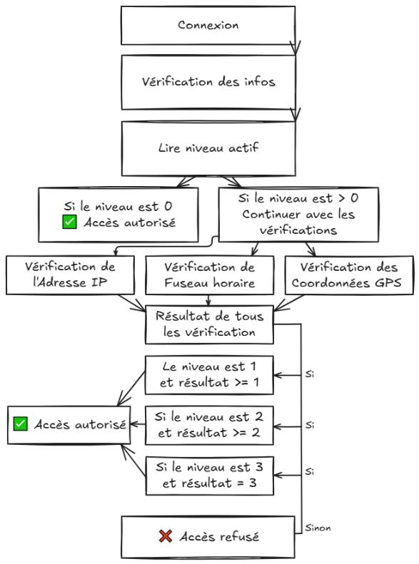

# Access-Control Design

The project studies how authentication and contextual policies can restrict application access. Administrators configure geographic, age and time conditions. The report and presentation also cover formal access-control modelling in P and a Python suspicious-login detection experiment.

## Geographic Policy

The report's geographic-policy flow combines IP address, time-zone and GPS checks according to the selected restriction level. This documents the academic design, not a guarantee of location verification.

## Visual Sources

All three images are unchanged extracts from `PFE-rapport.pdf`:

| Figure | Page |
| --- | --- |
| Time-policy settings | 76 |
| Age-policy settings | 74 |
| Geographic decision flow | 71 |

These are original report illustrations, not newly executed application screenshots. Full reports and presentations are not redistributed here.

This is collaborative academic work. Original application credits and the [team repository](https://github.com/Yassermar11/pfe) are retained; this publication does not claim sole authorship.
