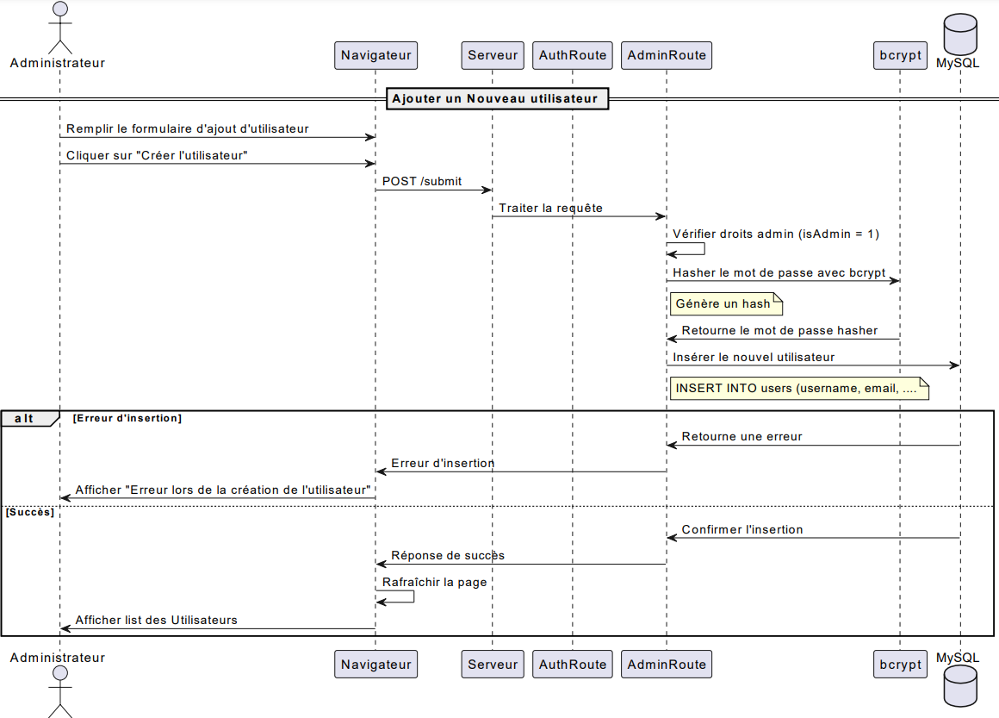
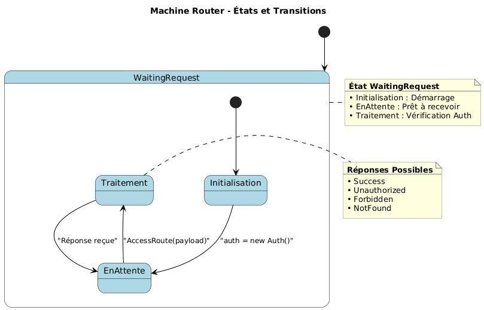

# Access-Control Design

The project studies how authentication and contextual policies can restrict application access. Administrators configure geographic, age and time conditions. The report and presentation also cover formal access-control modelling in P and a Python suspicious-login detection experiment.

## Geographic Policy

The report's geographic-policy flow combines IP address, time-zone and GPS checks according to the selected restriction level. This documents the academic design, not a guarantee of location verification.

## User Administration

The original design follows the request from browser to server, checks administrator rights, hashes the password with bcrypt and inserts the user into MySQL. The sequence includes success and insertion-error paths.

## Formal Access Model

The report models application interactions as state machines in P. The Router delegates access decisions to Auth and receives response events. The diagram is a design artifact, not evidence that formal verification was rerun for this publication. The corresponding source is [model.p](../model.p).

## Read the Implementation

Start with [server.js](../server.js), then [access middleware](../fonctionnel/middlewares.js) and [security routes](../fonctionnel/routes/securityRoutes.js). The [policy interface](../views/policy.html) exposes the administrative controls. These files allow the diagrams to be compared with the implementation rather than treated as runtime guarantees.

## Visual Sources

All six images are unchanged extracts from `PFE-rapport.pdf`:

| Figure | Page |
| --- | --- |
| Time-policy settings | 76 |
| Age-policy settings | 74 |
| Geographic decision flow | 71 |
| Geographic-policy settings | 72 |
| User-creation sequence | 33 |
| Router state machine | 106 |

These are original report illustrations, not newly executed application screenshots. Full reports and presentations are not redistributed here.

This is collaborative academic work. Original application credits and the [team repository](https://github.com/Yassermar11/pfe) are retained; this publication does not claim sole authorship.
